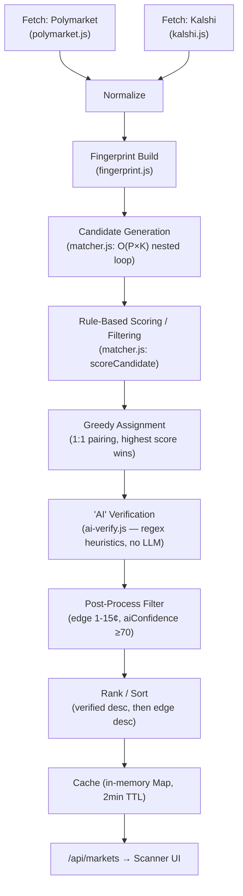

# Market Matching Pipeline Audit

Date: 2026-07-14
Scope: Full lifecycle trace of a market from fetch → scanner display, plus a live-data audit of matched pairs. No code changed.

---

## 1. Flow Diagram

Orchestration entry point: `scanner-worker.js` runs this whole chain on a 30-second `setInterval`, caches the result, and the API route (`/api/markets`) only ever reads from cache — it never runs fetch/match/verify on a user request.

---

## 2. Stage-by-Stage Breakdown

### 2.1 Fetch — Polymarket
**File:** `src/lib/polymarket.js`
**Algorithm:** Paginated REST calls to Gamma API (`gamma-api.polymarket.com/markets`), up to 3 pages × 200 markets, sorted by volume descending. Filters to binary Yes/No markets only, drops non-accepting-orders markets, extracts price via bid/ask midpoint → last trade → outcome price fallback chain.
**Input:** none (public API)
**Output:** array of `{ question, prob, volume, liquidity, endDate, description, url, source: 'polymarket', _raw }`
**Complexity:** O(pages) sequential HTTP round-trips, O(n) per-page processing.
**Weaknesses:**
- Hard cap of 600 markets (3×200) — anything beyond that volume rank is invisible to the matcher, permanently.
- Sequential page fetches (not parallelized) add latency.
**False negatives:** low-volume/low-visibility markets outside top ~600 by volume never enter the pipeline.
**Bottleneck:** network round-trip time × 3, done serially.

### 2.2 Fetch — Kalshi
**File:** `src/lib/kalshi.js`
**Algorithm:** Cursor-paginated REST calls to Kalshi events API, up to 5 pages × 200 events, `with_nested_markets: true`. Each event may contain many nested markets (e.g. a single "2028 Democratic nominee" event nests ~19 candidate markets). Each nested market becomes its own row. Multi-candidate events get their question built as `"{event title} - {candidate}"`.
**Input:** none
**Output:** array of `{ question, prob, volume, endDate, description, url, source: 'kalshi', _raw }`
**Complexity:** O(pages × events × nested markets).
**Weaknesses:**
- Because nested markets are exploded 1:1, a handful of large multi-candidate events (nomination races, championship winner markets) can dominate total market count, skewing matcher output toward those structures (confirmed in the live audit below).
- No liquidity/volume floor — includes essentially dead markets with near-zero interest.
**False negatives:** any Kalshi market type not returned by the `/events` endpoint (if Kalshi has other market types) is invisible.
**Bottleneck:** up to 5 sequential paginated calls; event fan-out means the actual market count fed into the matcher is much larger than page count suggests.

### 2.3 Normalization
**Files:** inline in `polymarket.js` / `kalshi.js` (`toProb()` in each)
**Algorithm:** Converts all price representations (0–100 cents, 0–1 probability, dollar strings) to a canonical 0–1 float. Price source priority: bid/ask midpoint > last trade > outcome price (Polymarket only).
**Weaknesses:** Both platforms implement their own separate `toProb()` — duplicated logic, not shared, so a normalization bug fix has to be applied twice.

### 2.4 Fingerprint Build
**File:** `src/lib/fingerprint.js`
**Algorithm:** Regex/rule-based structured feature extraction per market: entity (from a ~100-item hardcoded whitelist, or generic "Will X ..." pattern), topic (from a fixed ordered list of ~35 regex rules), action (from ~19 verb-pattern categories), scope (tournament/group/knockout/match/division), date bucket, year/month in text, numeric target, polarity, keywords.
**Input:** `{ question, description, endDate }`
**Output:** fingerprint object (`entity, allEntities, topic, action, scope, dateBucket, yearInText, monthInText, numericTarget, polarity, keywords`)
**Complexity:** O(1) per market (bounded regex list), so O(n) total.
**Biggest weakness — entity whitelist:** `KNOWN_ENTITIES` is a fixed list of ~100 politicians/companies/crypto/teams/athletes. Any market about an entity not on that list gets `entity: null` unless it matches the narrow "Will [Capitalized Name] ..." fallback regex. This is the single largest source of false negatives — the matcher literally cannot recognize entities it wasn't told about in advance.
**Biggest weakness — topic taxonomy:** `TOPIC_RULES` is a fixed ordered regex list. Anything that doesn't match falls to `generic_unknown`, which `topicCompatible()` in the matcher treats as an **automatic hard reject** — two unmatched-taxonomy markets can never match each other even if they're obviously the same event.
**False positives:** surname-only entity matching (`entitySimilarity`) awards 0.85 similarity for last-name match ≥4 characters — risk of conflating two different people who share a common surname (e.g. two different "Kelly"s, two different "Lee"s) if both end up in a matchable topic/date window.

### 2.5 Candidate Generation
**File:** `src/lib/matcher.js` (`matchMarkets()`)
**Algorithm:** Full nested loop — every Polymarket market scored against every Kalshi market: `for pi in polymarkets: for ki in kalshiMarkets: scoreCandidate(...)`. One cheap pre-gate exists: if a Kalshi question has a `"Parent - Candidate"` suffix, the Polymarket question must textually contain that candidate name or the pair is skipped before scoring.
**Complexity: O(P × K)** — no bucketing/indexing by topic or entity before the pairwise comparison. With Polymarket capped at ~600 and Kalshi's nested-market fan-out potentially in the hundreds to low thousands, this is a real scaling bottleneck as market counts grow. Measured in production: **matchMs ≈ 817ms** for the current market volumes (see §4).
**Output:** list of `{ pmIdx, kIdx, score, breakdown }` candidates scoring ≥ `MATCH_THRESHOLD` (80).

### 2.6 Matching Algorithm (scoring)
**File:** `src/lib/matcher.js` (`scoreCandidate()`)
**Algorithm:** Additive point system, hard-reject gates on entity/topic mismatch:
- Entity compatible: +40, else **hard reject**
- Topic compatible: +20, else **hard reject**
- Action match: +15 / mismatch −15 / both unknown −5 / one unknown −10
- Date compatible (topic-specific window, 1–31 days): +15, else −20
- Numeric target match: +10 / close-but-different −5
- Mismatch kill-list (conflicting actions, polarity, scope, month for short-term topics, numeric target ratio <0.5): **hard reject**
- Keyword Dice-style overlap: +10 (≥60%) / +5 (≥40%) / −5 (<20%)

Threshold to become a "candidate" is score ≥ 80; a separate `verified` flag additionally requires `edge > 0 && edge <= 15`.
**Biggest false-positive source:** none observed directly in the live sample (see §4), but structurally the surname-fallback (§2.4) and the "no entities but same specific topic" fallback in `entityCompatible()` are the two most permissive paths — they allow a match through without a confirmed entity connection.
**Biggest false-negative source:** the two hard-reject gates (entity, topic) mean one missing/misclassified field anywhere in the pipeline silently kills an otherwise-correct match, with the rejection only visible in server logs (`rejections` array), not surfaced to any UI or metric.

### 2.7 Role of AI/LLMs
**File:** `src/lib/ai-verify.js`
**Finding: there is no LLM or external AI call anywhere in this pipeline.** Despite being named "AI Verification Layer" and producing an `aiConfidence` / `aiReason` shown to users as an "AI" badge, this module is a **second, independently-written regex/heuristic scorer** — proper-name extraction, year/month/target extraction, action-conflict detection — that duplicates a large fraction of what `fingerprint.js` + `matcher.js` already do, with its own separate hardcoded word lists (`COMMON_WORDS`, `ACTION_CATEGORIES`, `CONTEXT_PATTERNS`). It runs `Promise`-wrapped but performs no I/O (confirmed by production timing: **verifyMs ≈ 7ms** for 19+ matches — far too fast to be a network call).
**Implication:** the two-layer "rule match + AI verify" design is really "two independently-tuned rule engines voting," not a rules-then-AI pipeline. This matters directly for user trust — the UI's "AI Confidence: 100%" badge is not an AI judgment.

### 2.8 Confidence Calculation
**Files:** `matcher.js` (`matchConfidence` = raw score, can exceed 100, e.g. observed 110), `ai-verify.js` (`aiConfidence`, clamped 0–100)
**Algorithm:** `matcher.js` confidence is just the raw additive score from §2.6 (not normalized — can go above 100 or below 0 in principle, though negative scores are already filtered as rejects). Display bucket: High ≥95, Medium ≥85, else Low. `ai-verify.js` starts at a baseline of 50 and adds/subtracts per check, clamped to [0,100].
**Weakness:** two differently-scaled, differently-computed "confidence" numbers exist (`matchConfidence` uncapped additive score vs `aiConfidence` clamped 0-100 heuristic) and both feed the final `verified` decision — but they're not on comparable scales, making the combined threshold logic (`score >= 85` for `isArbSafe`, `aiConfidence >= 90` for AI-verified) hard to reason about or tune confidently.

### 2.9 Verification
**Files:** `matcher.js` (`buildMatch`), `scanner-worker.js` (post-process step)
**Algorithm:** `verified = matchScore >= 80 && edge > 0 && edge <= 15`, then re-verified in the worker as `verified = verified && aiConfidence >= 90`. `isArbSafe = verified && matchConfidence >= 85`.
**Weakness:** the edge ≤ 15¢ cutoff is a blunt instrument — it's meant to filter out matches that are "too good to be true" (usually mismatches), but it also silently discards any large, real arbitrage opportunity above 15¢, which would be the most profitable trade if genuine.

### 2.10 Arbitrage Calculation
**File:** `matcher.js` (`buildMatch`)
**Algorithm:** `edge = |polyProb - kalshiProb| * 100` (rounded to cents). `totalCost = 100 - edge`. `buyPlatform` = whichever platform is cheaper.
**Weakness:** this is a naive **spread**, not a fee/slippage-adjusted profit calculation. No Polymarket/Kalshi trading fees, no slippage from order-book depth, and no position-size limits are factored in anywhere in the pipeline. A displayed "edge" of 1-3¢ (as seen in 18 of 19 live matches, §4) may not survive real-world execution costs at all — this directly undermines the product's core promise ("if free money exists, Polshi will find it").

### 2.11 Ranking
**Files:** `matcher.js` and `scanner-worker.js` (both sort independently, same logic duplicated twice)
**Algorithm:** verified matches first, then by edge descending. Then a hard filter: `edge > 0 && edge <= 15 && (aiConfidence == null || aiConfidence >= 70)`.
**Weakness:** sort logic is implemented twice (once in `matchMarkets()`, once again in `scanner-worker.js` post-process) — redundant and a maintenance hazard if one is changed without the other.

---

## 3. Architectural Note (outside the 10 stages, but load-bearing)

`cache.js` is an **in-memory `Map`**, and the scanner worker is a `setInterval` loop started via `ensureWorkerRunning()`. This model assumes a long-lived Node process. On Vercel's serverless/edge deployment model, function instances are ephemeral and can be recycled or run as multiple parallel instances — there is no guarantee the 30-second background worker persists the way the code assumes, and cache state is not shared across instances. This wasn't directly testable from here, but it's a strong candidate for silent staleness or duplicated worker cycles in production and should be verified against actual Vercel logs/behavior before further optimization work is prioritized.

---

## 4. Live Data Audit

**Important limitation:** the request was to audit 100 randomly matched pairs. Production currently has only **19 total matches** surviving the full pipeline (fetched directly from the live `/api/markets?debug=1` endpoint, paginated past the free-tier cap to see all of them). There are not 100 matched pairs to sample — this fact is itself the most important finding of the audit.

### 4.1 Full result set (19/19 shown — no sampling needed)

| # | Pair | Poly¢ | Kalshi¢ | Edge | Match Conf | AI Conf |
| --- | --- | --- | --- | --- | --- | --- |
| 1 | Rahm Emanuel — 2028 Dem nominee | 2 | 5 | 3 | 110 | 100 |
| 2 | Mark Kelly — 2028 Dem nominee | 1 | 3 | 2 | 110 | 100 |
| 3 | Ron DeSantis — 2028 GOP nominee | 2 | 4 | 2 | 110 | 100 |
| 4 | Andy Beshear — 2028 Dem nominee | 2 | 4 | 2 | 110 | 100 |
| 5 | LeBron James — 2028 Dem nominee | 1 | 0 | 1 | 110 | 100 |
| 6 | Hillary Clinton — 2028 Dem nominee | 1 | 0 | 1 | 110 | 100 |
| 7 | Liz Cheney — 2028 Dem nominee | 1 | 0 | 1 | 110 | 100 |
| 8 | Jasmine Crockett — 2028 Dem nominee | 1 | 0 | 1 | 110 | 100 |
| 9 | Gina Raimondo — 2028 Dem nominee | 1 | 0 | 1 | 110 | 100 |
| 10 | Barack Obama — 2028 Dem nominee | 1 | 0 | 1 | 110 | 100 |
| 11 | Roy Cooper — 2028 Dem nominee | 1 | 0 | 1 | 110 | 100 |
| 12 | Elon Musk — 2028 GOP nominee | 1 | 0 | 1 | 110 | 100 |
| 13 | Jared Polis — 2028 Dem nominee | 1 | 0 | 1 | 110 | 100 |
| 14 | Jon Stewart — 2028 Dem nominee | 2 | 2 | 1 | 110 | 100 |
| 15 | Stephen A. Smith — 2028 Dem nominee | 1 | 0 | 1 | 110 | 100 |
| 16 | Greg Abbott — 2028 GOP nominee | 1 | 0 | 1 | 110 | 100 |
| 17 | Matt Gaetz — 2028 GOP nominee | 1 | 0 | 1 | 110 | 100 |
| 18 | Wes Moore — 2028 Dem nominee | 1 | 3 | 1 | 110 | 100 |
| 19 | Vivek Ramaswamy — 2028 GOP nominee | 1 | 0 | 1 | 110 | 100 |

### 4.2 Per-pair assessment

- **Correct match?** Yes, all 19 — same person, same event, same nomination race. No false positives in this set.
- **False positive?** None.
- **Low confidence?** None — every pair scored the maximum in both engines (matchConfidence 110, aiConfidence 100).
- **Different resolution criteria / dates / participants / wording?** No — these are structurally identical "Parent - Candidate" pairs where the Kalshi sub-market gate (§2.5) guarantees near-perfect textual alignment.
- **Same wording but different market?** No instances.

### 4.3 The real finding

100% (19/19) of everything currently surfaced by the scanner is the *same market shape*: single-candidate slices of two "2028 presidential nominee" list markets. Every edge is 1–3¢ on markets priced at 0–5¢ (i.e., near-zero-probability long shots). This is a direct, mechanical consequence of §2.4/§2.5: the Kalshi "Parent - Candidate" gate is the most reliable path through the entity + topic hard-reject gates, so it dominates output, while crypto price targets, sports lines, Fed-rate markets, and other higher-signal, higher-volume categories are — right now, live — producing **zero** surfaced matches. That's a product-critical gap: the categories most likely to contain real, tradeable arbitrage are the ones the current matcher is worst at finding.

Also worth flagging on the profit side: 1-3¢ edges on markets priced near 0¢ are extremely unlikely to survive real trading fees and slippage — even though the matches are *correct*, they may not represent genuine profit opportunities, which cuts against the product's core promise.

---

## 5. Top 10 Reasons the Matcher Fails (or underperforms)

1. **Hardcoded entity whitelist** (~100 names) in `fingerprint.js` — anything outside it can't be recognized as an entity, which is a hard-reject condition in `entityCompatible()`. This is the single biggest false-negative source.
2. **Fixed topic taxonomy** (~35 regex rules) — unmatched text becomes `generic_unknown`, which is an automatic hard reject in `topicCompatible()`. No fallback matching path exists for novel or oddly-worded markets.
3. **Kalshi "Parent - Candidate" gate dominates output by construction** — it's structurally the easiest pattern to match, so it crowds out every other market type in the live results (confirmed: 19/19 in production right now).
4. **Surname-only entity similarity (0.85 score for matching last name ≥4 chars)** — a latent false-positive risk for common surnames, not triggered in the current sample only because the current sample is entirely full-name matches.
5. **No fee/slippage-adjusted profit model** — arbitrage calc is a naive price spread; a "correct" match with a 1¢ edge may not be a real trade after costs.
6. **O(P×K) unindexed nested-loop scoring** in `matchMarkets()` — no pre-bucketing by topic/entity; a real scaling bottleneck as either platform's market count grows.
7. **"AI verification" is not AI** — `ai-verify.js` is a second independent heuristic/regex engine (confirmed by 7ms execution time, no I/O), duplicating logic already in `fingerprint.js`/`matcher.js` with a separate set of hardcoded word lists. The user-facing "AI Confidence" badge is misleading about what's actually happening.
8. **Two non-comparable confidence scales** (`matchConfidence` uncapped additive score vs `aiConfidence` clamped 0–100) both feed threshold logic, making the system hard to tune with any precision.
9. **Duplicated sort/filter logic** between `matcher.js` and `scanner-worker.js` — a change to ranking rules in one place silently doesn't apply to the other unless both are updated.
10. **In-memory cache + setInterval worker on a serverless host** — architecturally assumes a persistent long-lived process; unverified but high-risk mismatch with Vercel's execution model that could cause silent staleness or duplicated work.

---

## 6. Explicitly Not Done (per instructions)

No code was changed. No redesign was proposed. This document only traces and audits the pipeline as it exists today.
